## Android 4.2 build AAN39
Reconstructed on 14 October 2026.

Notable features:
- Bootanimation behaviour changes
- Redesigned notifications pane on Phone/Phablet UI
- Notification changes
- Google Search is now included on the Lock screen slider for all device sizes
- Changes on app transition animations
- Changes on Google Search slider from System Bar
- Optimizations in apps drawer
- Changes on Launcher app icon scaling
- Launcher home screen scrolling behaviour on Tablet UI is now unified with Phone/Phablet UI
- Launcher rotation in Phablet UI
- Removal of all Android Honeycomb leftover assets from Tablet UI launcher
- Power menu on tablets is no longer enabled by default
- Removal of dual-pane settings on Phablet UI
- Dual-pane on the Calendar on Phablet UI

The manifest is available for compile here -  https://github.com/froyocomb/android/tree/jolly-bean-jolly-bean/4.2/AAN39.xml

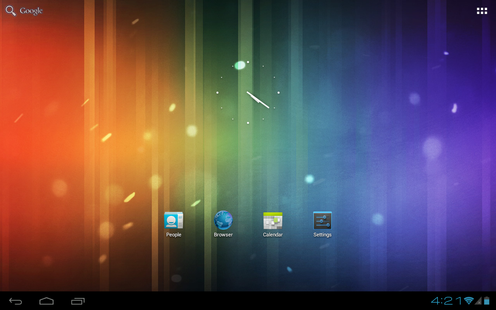

---

## Android 4.2 build AAN25
Reconstructed on 13 October 2026.  
This is also the first Android MASTER tagged build.

Since this is (in theory) the first build of Android 4.2, there are no major changes compared to Android 4.1 build JRN23B.

The manifest is available for compile here -  https://github.com/froyocomb/android/tree/jolly-bean-jolly-bean/4.2/AAN25.xml

---

## Android 4.1 build JRO02D
Reconstructed on 6 October 2026.  
This is the last build to be identified as Android 4.1

Notable features:
- Fixed Tablet UI "lights-out" layout
- The Tablet UI notifications pane is now disabled on Setup Wizard

The manifest is available for compile here -  https://github.com/froyocomb/android/tree/jolly-bean-jolly-bean/4.1/JRO02D.xml

 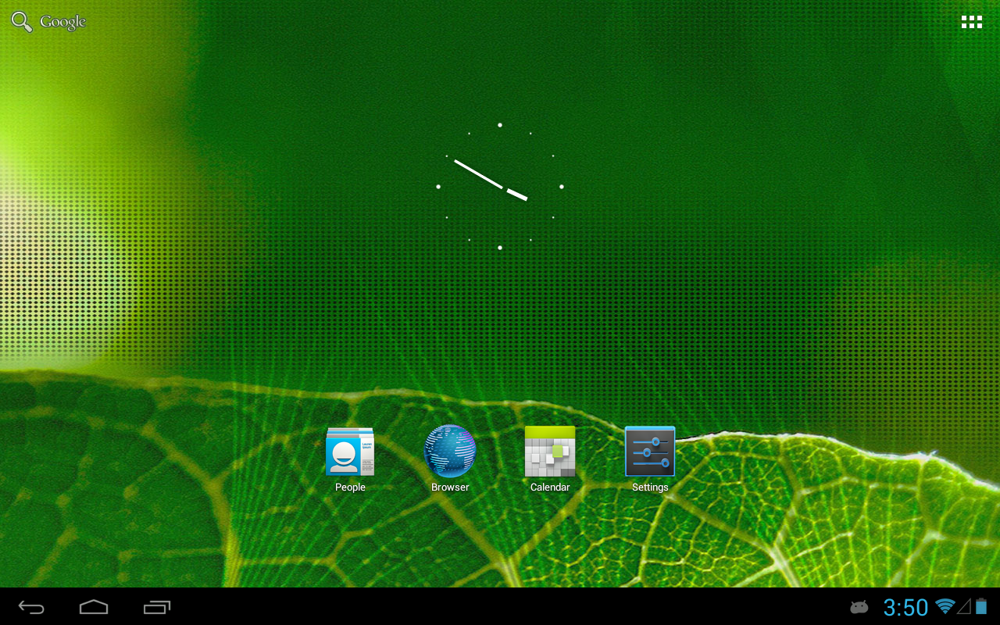

---

## Android 4.1 build JRN84D
Reconstructed on 6 October 2026.

Notable features:
- Lock screen slider tweaks
- Navigation buttons highlight are now white
- Re-introduction of expanded notifications on Tablet UI
- The unlock fade effect has been reverted to the old behaviour

The manifest is available for compile here -  https://github.com/froyocomb/android/tree/jolly-bean-jolly-bean/4.1/JRN84D.xml

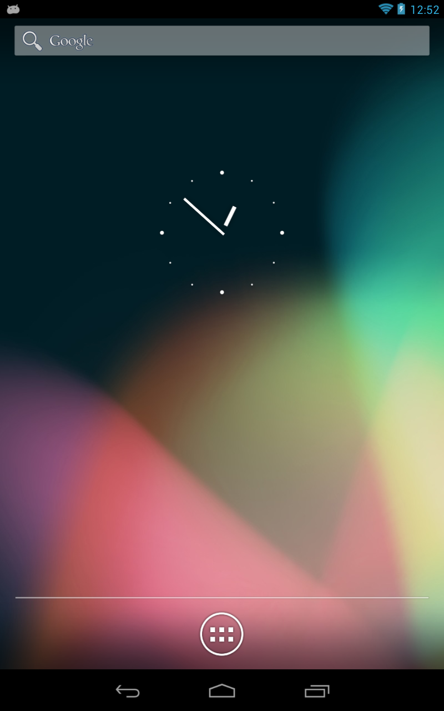 

---

## Android 4.1 build JRN75E
Reconstructed on 6 October 2026.

Notable features:
- New Lock screen slider
- Changes on recents page background on Phablet UI
- Changes on notifications pane header for Phone/Phablet UI
- New System Bar panel for Tablet UI
- Launcher is no longer locked in portrait position on Phone/Tablet UI
- Minor changes on Phablet UI clings
- New app transition while closing an app while on apps drawer
- New clock app transition
- Holo background is now enabled for non-accelerated devices

The manifest is available for compile here -  https://github.com/froyocomb/android/tree/jolly-bean-jolly-bean/4.1/JRN75E.xml

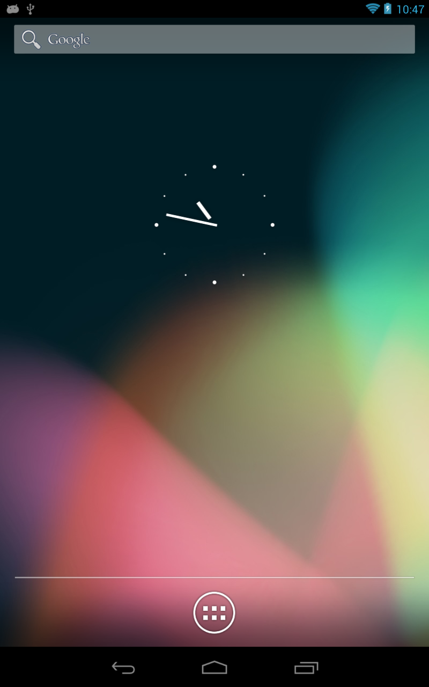 

---

## Android 4.1 build JRN64
Reconstructed on 6 October 2026.

Notable features:
- Official Nexus 7 support
- All AOSP Live wallpaers are now included by default
- New default wallpaper for Phone/Phablet UI
- Minor Lock screen layout fixes on Phablet UI
- New unlock fade effect
- Simplified notifications pane background for Phone/Phablet UI
- Fixed Launcher portrait position on Phone/Tablet UI
- New wallpapers for Phablet UI (they're all from the Nexus 7)
- New wallpaper option for the Phone UI
- Redesigned Widgets drawer preview
- Minor app icon changes
- Minor changes on the Lock screen slider
- Power menu on tablets is re-enabled by default
- New mouse pointer arrow
- New clock app transition

The manifest is available for compile here -  https://github.com/froyocomb/android/tree/jolly-bean-jolly-bean/4.1/JRN64.xml

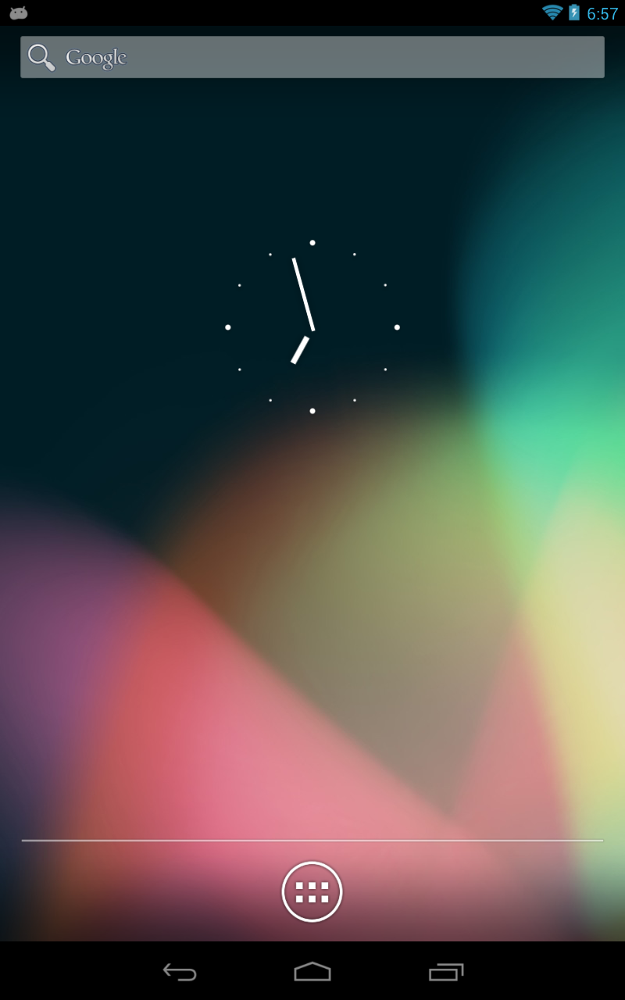 

---

## Android 4.1 build JRN51C
Reconstructed on 6 October 2026.

Notable features:
- New default wallpaper (ew)
- Translucent Google Search box
- Cling updates on Phablet UI Launcher
- New Launcher widget resize assets
- New switches assets
- New disconnected network icons

The manifest is available for compile here -  https://github.com/froyocomb/android/tree/jolly-bean-jolly-bean/4.1/JRN51C.xml

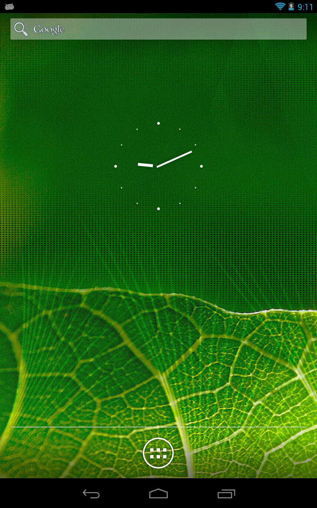 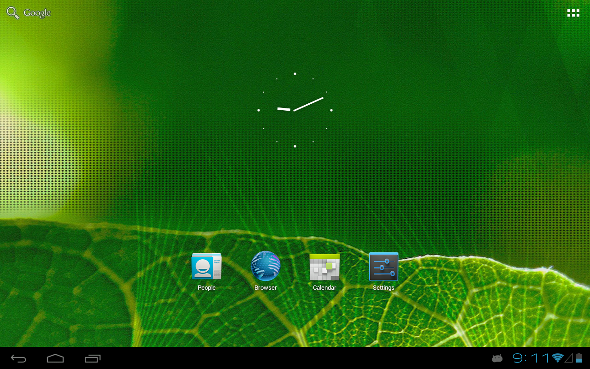

---

## Android 4.1 build JRN00 (JRN47)
Reconstructed on 5 October 2026.  
Gee, a 0 april 2012 build?? /j

Notable features:
- Final Jelly Bean easter egg
- Minor app transition changes
- Minor notification pane changes on Phone/Phablet UI
- Notifications layout fixes
- Settings Wi-Fi page now uses buttons for WPS and for add a new network
- Recent page changes on Phablet UI
- Removal of Google search on the Lock screen slider and navigation bar
- Removal of Launcher rotation in Phablet UI
- Rounded corners on Google Search box
- Reverted changes on Google Search box behaviour while opening the apps drawer

The manifest is available for compile here -  https://github.com/froyocomb/android/tree/jolly-bean-jolly-bean/4.1/JRN00-JRN47.xml

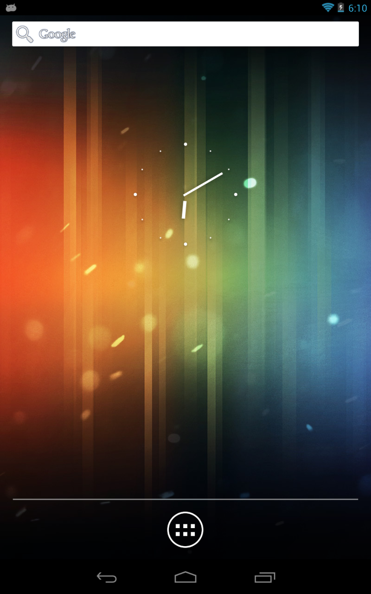 

---

## Android 4.1 build JRN44C
Reconstructed on 5 October 2026.

Notable features:
- Android version is now 4.1, API 16
- Introduction of Jelly Bean easter egg
- Fixes for bootanimation timing
- Animation changes on the Lock screen slider
- Minor app transition changes
- Redesigned notifications pane on Phone/Phablet UI
- Notifications redesign
- Solid white Google search box
- Changes on Google Search box behaviour while opening the apps drawer
- Removal of dual-pane settings on Phablet UI
- Dual-pane on the Calendar on Phablet UI

The manifest is available for compile here -  https://github.com/froyocomb/android/tree/jolly-bean-jolly-bean/4.1/JRN44C.xml

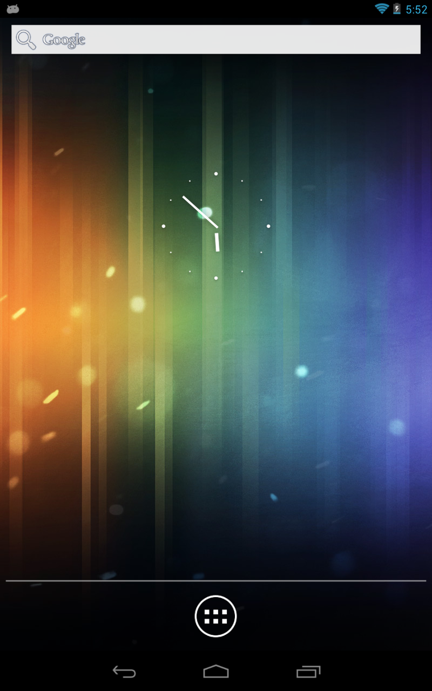 

---

## Android 4.1 build JRN38B
Reconstructed on 3 October 2026.

Notable features:
- Nexus 7 support!! (in practice)
- Notification changes
- Changes on app transition animations
- Changes in Phablet UI notifications pane
- Google Search is now included on the Lock screen slider and navigation bar
- New Launcher wallpaper dialog
- Launcher2 home screen scrolling behaviour on Tablet UI is now unified with Phone/Phablet UI
- UnifiedEmail is no longer in use

The manifest is available for compile here -  https://github.com/froyocomb/android/tree/jolly-bean-jolly-bean/4.1/JRN38B.xml

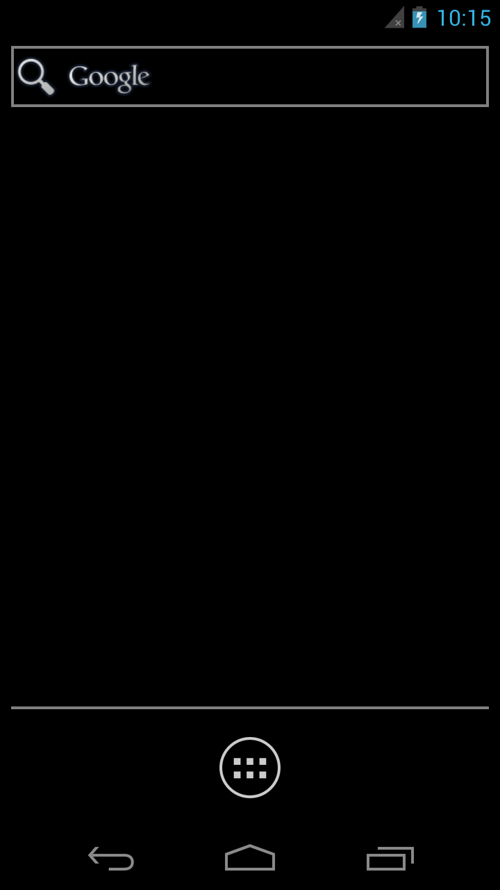 

---

## Android 4.1 build JRN30C
Reconstructed on 3 October 2026.

Notable features:
- Bootanimation behaviour changes
- Notification changes
- New app transition animations
- Power menu on tablets is no longer enabled by default
- Launcher rotation in Phablet UI
- Removal of all Android Honeycomb leftover assets from Tablet UI launcher
- Optimizations in apps drawer

The manifest is available for compile here -  https://github.com/froyocomb/android/tree/jolly-bean-jolly-bean/4.1/JRN30C.xml

 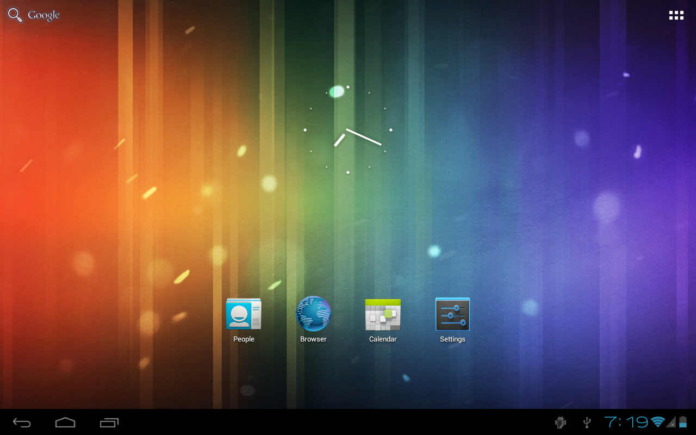

---

## Android 4.1 build JRN23B
Reconstructed on 2 October 2026.

Notable features:
- Introduction of the Phablet UI system wide
- More notification updates
- More UI optimizations

The manifest is available for compile here -  https://github.com/froyocomb/android/tree/jolly-bean-jolly-bean/4.1/JRN23B.xml

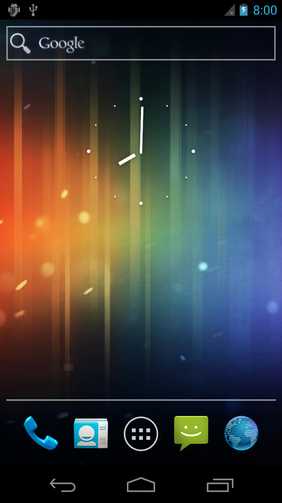 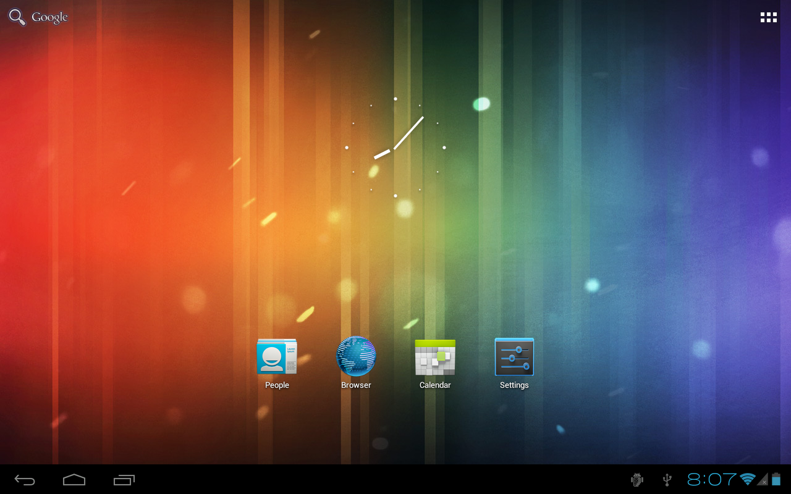

---

## Android 4.1 build JRN16C
Reconstructed on 30 September 2026.

Notable features:
- Final rotation animation
- Internal changes for System Bar
- Changed the storage path to /storage/sdcard0
- Android Dreams is no longer enabled by default

The manifest is available for compile here -  https://github.com/froyocomb/android/tree/jolly-bean-jolly-bean/4.1/JRN16C.xml

---

## Android 4.1 build JRN02D
Reconstructed on 29 September 2026.

Notable features:
- Re-implementation of Recents page animations, also adding a fade out animation while closing all apps
- New app transition animation
- Initial support for expanded notifications
- Initial support for User management
- Power options is no longer disabled on Tablets by default

The manifest is available for compile here -  https://github.com/froyocomb/android/tree/jolly-bean-jolly-bean/4.1/JRN02D.xml

 

---

## Android 4.1 build JRM81C
Reconstructed on 29 September 2026.

Notable features:
- Bugfixes, mostly in the user interface and the Clock app
- New rotation animation

The manifest is available for compile here -  https://github.com/froyocomb/android/tree/jolly-bean-jolly-bean/4.1/JRM81C.xml

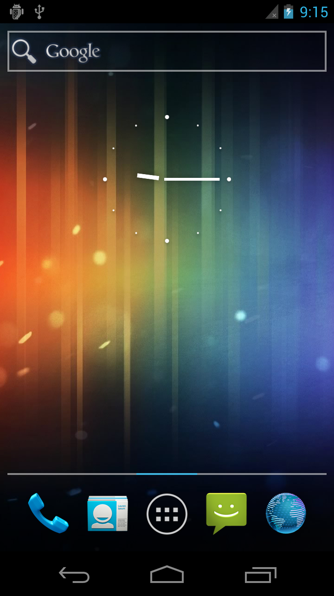 

---

## Android 3.0 build HRG75
Reconstructed on 23 September 2026.

HRG71C has been deprecated because of this build and HRG69.

Notable features:
- Holo clock, new purple wallpaper
- New Launcher2 main icons
- Very blue browser title bar, more Holo-esque
- Other stuff, like external/llvm/*** prefixed stuff being moved to frameworks/compile and stuff

The manifest is available for compile here - https://github.com/froyocomb/android/tree/froyocomb/beta/HRG75.xml

Enjoy!

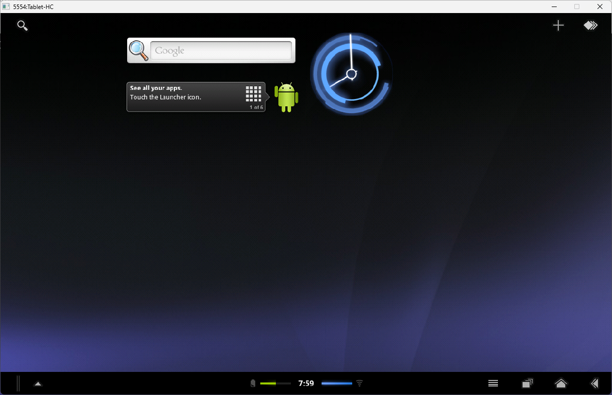 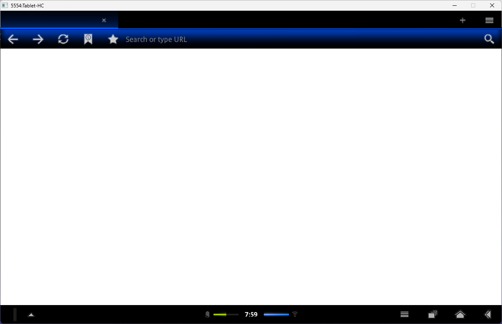

---

## Android 4.1 build JRM74
Reconstructed on 23 September 2026.

Notable features:
- More Phablet UI Launcher tweaks
- Merged Camera into the Gallery app

Note: Wi-Fi does not work on the Galaxy Nexus for this build.

The manifest is available for compile here -  https://github.com/froyocomb/android/tree/jolly-bean-jolly-bean/4.1/JRM74.xml

 

---

## Android 4.1 build JRM65C
Reconstructed on 23 September 2026.

Notable features:
- Initial support for Phablet UI Launcher
- New Tablet downloads page
- Lock fade out effect is now removed

Note: Wi-Fi does not work on the Galaxy Nexus for this build.

The manifest is available for compile here -  https://github.com/froyocomb/android/tree/jolly-bean-jolly-bean/4.1/JRM65C.xml

 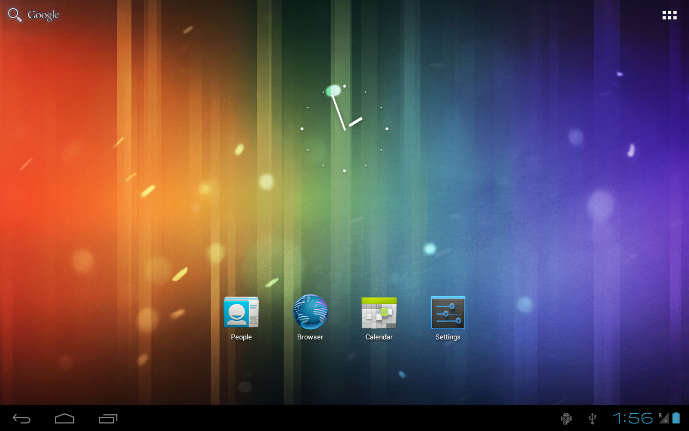

---

## Android 4.1 build JRM54
Reconstructed on 22 September 2026.

Notable features:
- Keyboard lag fix

Note: Wi-Fi does not work on the Galaxy Nexus for this build.

The manifest is available for compile here -  https://github.com/froyocomb/android/tree/jolly-bean-jolly-bean/4.1/JRM54.xml

 

---

## Android 4.1 build JRM47
Reconstructed on 22 September 2026.

Notable features:
- Initial support for xxhdpi
- Application debugging on Developer options

Note: Wi-Fi does not work on the Galaxy Nexus for this build.

The manifest is available for compile here -  https://github.com/froyocomb/android/tree/jolly-bean-jolly-bean/4.1/JRM47.xml

 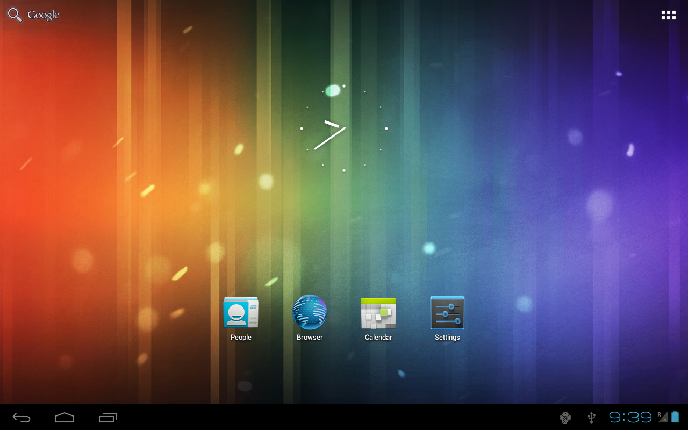

---

## Android 4.1 build JRM40
Reconstructed on 21 September 2026.

Notable features:
- Developer options toggle

The manifest is available for compile here -  https://github.com/froyocomb/android/tree/jolly-bean-jolly-bean/4.1/JRM40.xml

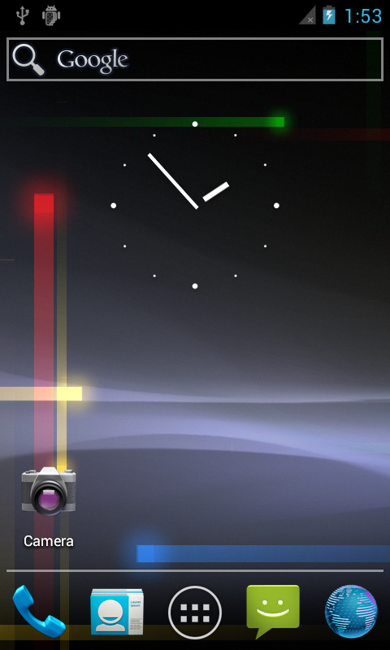 

---

## Android 3.0 build HRG69
Reconstructed on 20 September 2026.

Notable features:
- New system bar and panel art work, making both a much more "Holo" design
- The bee-flavored Honeycomb platform logo

That is basically it, though i can't take this build seriously with the leaf wallpaper. It just doesn't fit.

The manifest is available for compile here - https://github.com/froyocomb/android/tree/froyocomb/beta/HRG69.xml

Enjoy!

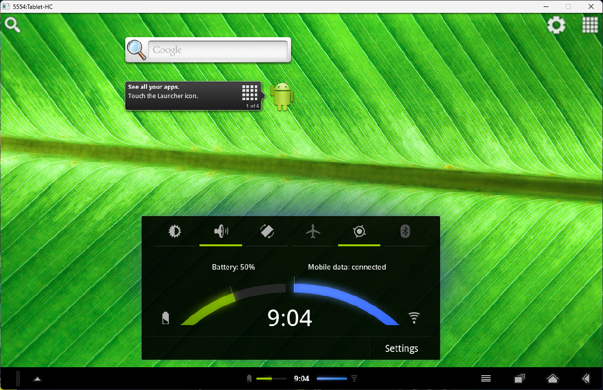 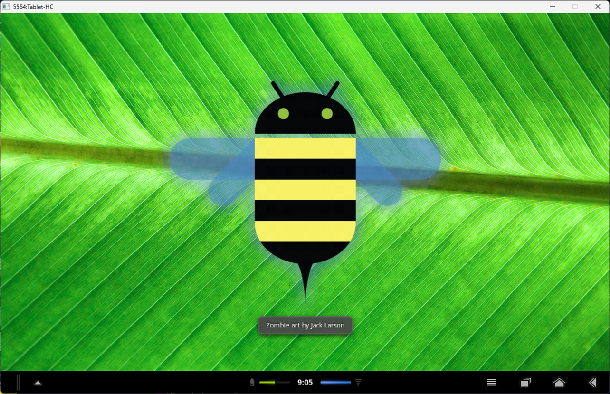

---

## Android 4.1 build JRM33
Reconstructed on 20 September 2026.

Notable features:
- Not much, just bug fixes

The manifest is available for compile here -  https://github.com/froyocomb/android/tree/jolly-bean-jolly-bean/4.1/JRM33.xml

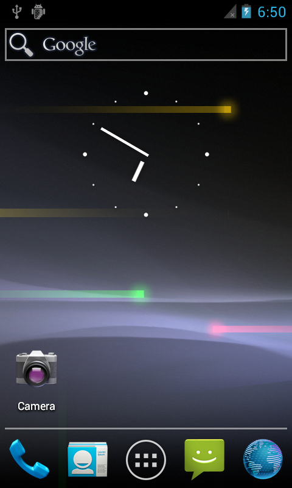 

---

## Android 4.1 build JRM24
Reconstructed on 17 September 2026.

Notable features:
- JellyBean!!! goodbye ICS MR2
- New rotation animation
- Reintroduction of the "No service" cellular icon

See here - see by yourself lol  
Available here - https://github.com/froyocomb/android/tree/jolly-bean-jolly-bean/4.1/JRM24.xml

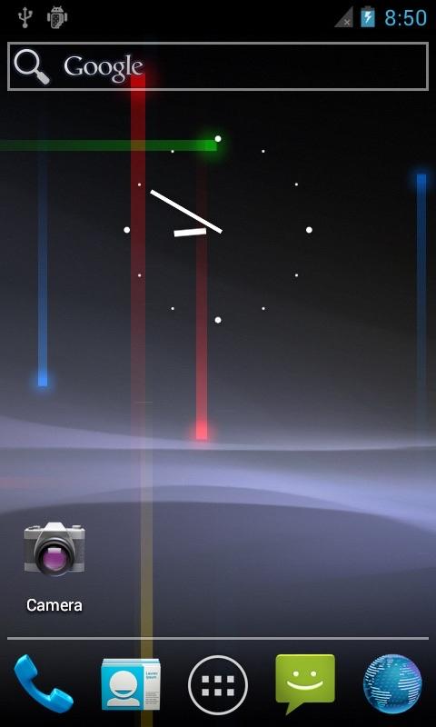 

---

## Android 3.0 build HRG64
Reconstructed on 19 September 2026.

HRG61 is discontinued because of this build and HRG56.

Notable features:
- New artwork for the system bar and panel, you can see in the photos
- The Launcher2 icons are now more spaced out
- Contacts is now Aero glass (jk)
- New Recents button on the system bar, though the old MENU one is still there, pressing it crashes SystemUI

That is basically it, this is the last build to be of the whiteboard era, the next build will fully embrace the early Holo design.

The manifest is available for compile here - https://github.com/froyocomb/android/tree/froyocomb/beta/HRG64.xml

Enjoy!

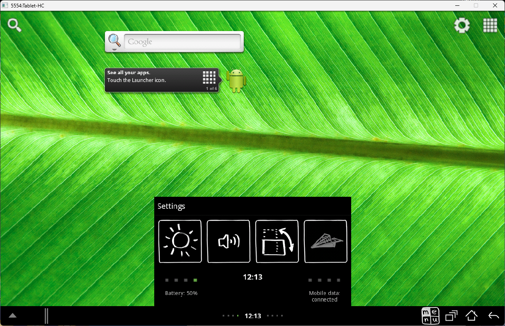 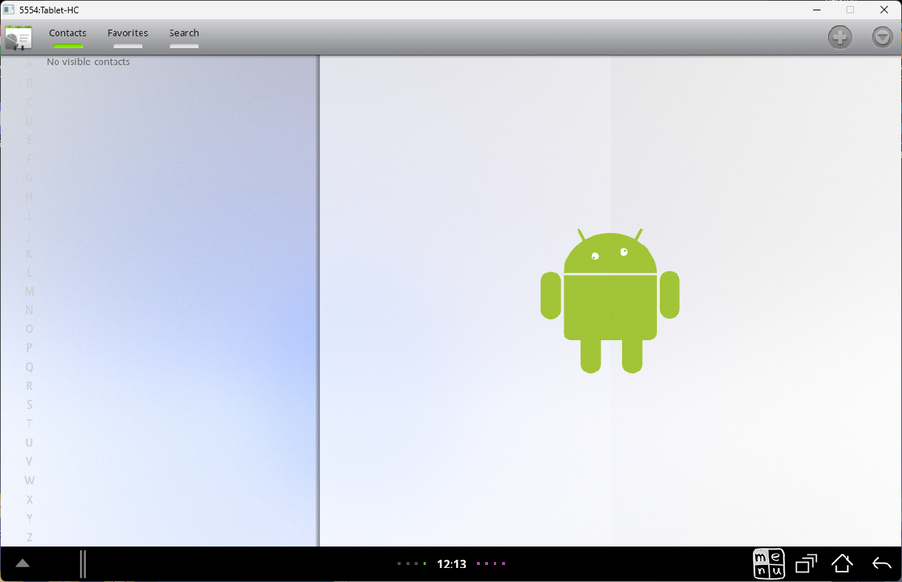

---

## Android 4.1 build IRM18
Reconstructed on 17 September 2026.

Notable features:
- More UI optimizations
- Torospr support
- Tablet UI fixes

See here - https://betawiki.net/wiki/Android_4.1_build_IRM18  
Available here - https://github.com/froyocomb/android/tree/jolly-bean-jolly-bean/4.1/IRM18.xml

 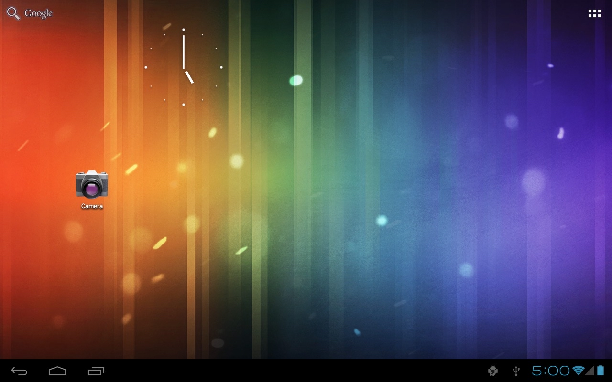

---

## Android 3.0 build HRG56
Reconstructed on 17 September 2026.

Notable features:
- New Holo UI elements
- New screenshot feature

See here - https://betawiki.net/wiki/Android_3.0_build_HRG56  
Available here - https://github.com/froyocomb/android/tree/froyocomb/beta/HRG56.xml

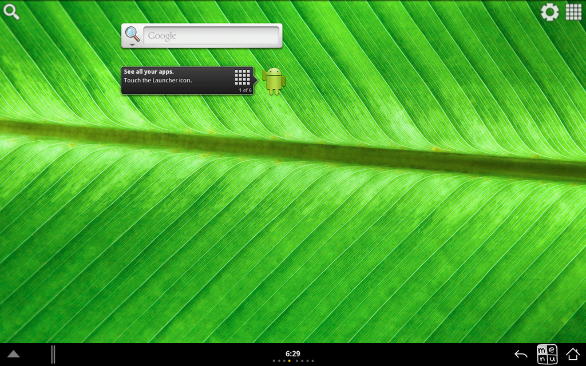

---

## Android 4.1 build IRM12
Reconstructed on 15 September 2026.

Notable features:
- New default wallpaper
- Optimizations in Launcher2
- UnifiedEmail, whatever that means

See here - https://betawiki.net/wiki/Android_4.1_build_IRM12  
Available here - https://github.com/froyocomb/android/tree/jolly-bean-jolly-bean/4.1/IRM12.xml

 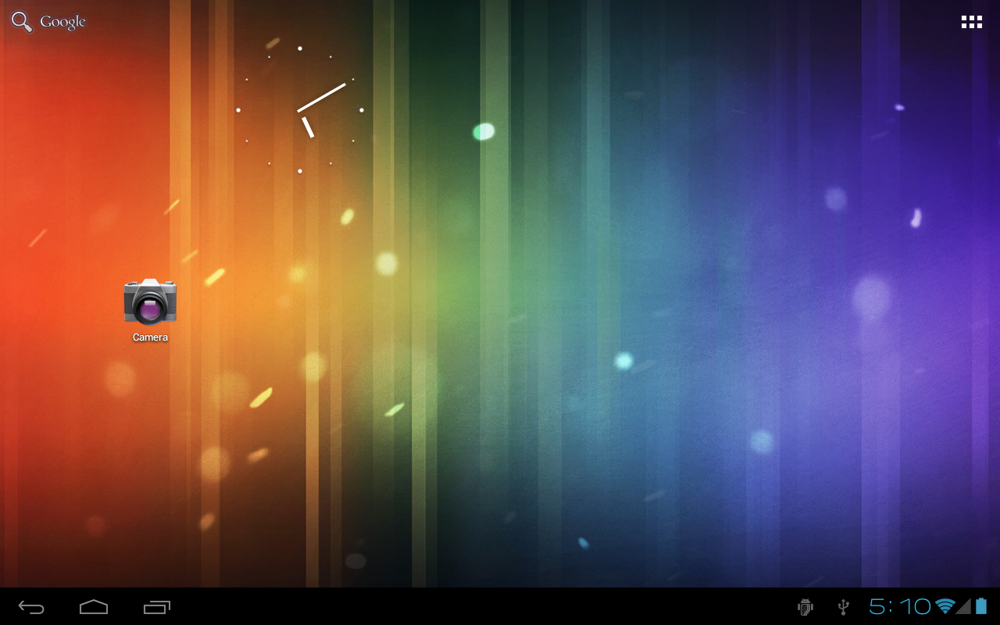

---

## Android 4.1 build IRM05
Reconstructed on 14 September 2026.

See here - https://betawiki.net/wiki/Android_4.1_build_IRM05  
Available here - https://github.com/froyocomb/android/tree/jolly-bean-jolly-bean/4.1/IRM05.xml

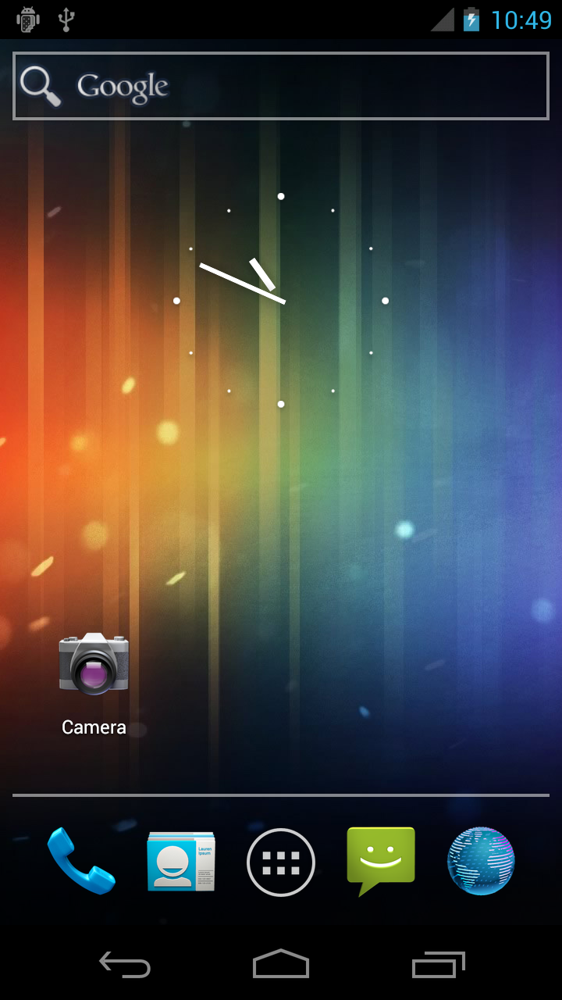 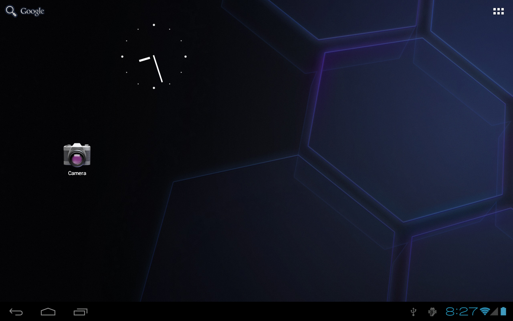

---

## Android 4.1 build IRL82
Reconstructed on 14 September 2026.

Notable features:
- Optimizations in Launcher2

See here - https://betawiki.net/wiki/Android_4.1_build_IRL82  
Available here - https://github.com/froyocomb/android/tree/jolly-bean-jolly-bean

---

## Android 3.0 build HRG50B
Reconstructed on 11 September 2026.

Notable features:
- Lock screen on xlarge
- Functional battery and status meters
- Updated all apps
- Updated customization drawer
- Two-pane settings
- Some Browser updates

See here - https://betawiki.net/wiki/Android_3.0_build_HRG50B  
Available here - https://github.com/froyocomb/android/tree/froyocomb

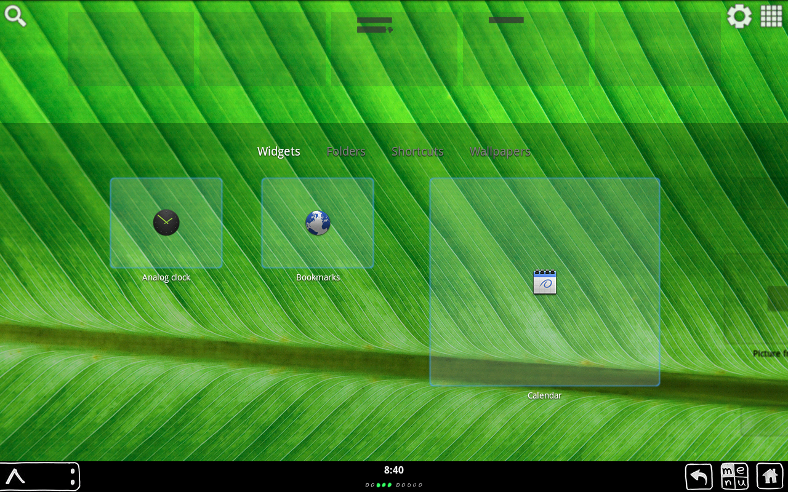

---

## Android 3.0 build HRG44B
Redone on 31 August 2026.

Notable features:
- Settings panel
- Holo checkboxes and radio buttons
- Launcher2 is now a 8x7 grid
- Gingerbread easter egg
- Redesigned Browser
- Camera now has a Time Lapse option

See here - https://betawiki.net/wiki/Android_3.0_build_HRG44B  
Available here - https://github.com/froyocomb/android/tree/froyocomb

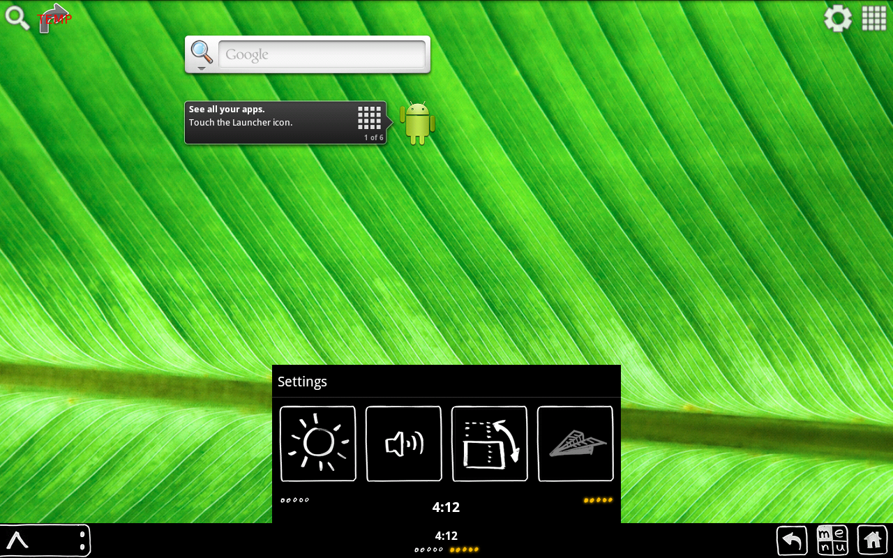

---

## Android 3.0 build HRG37
Reconstructed on 29 August 2026.

Notable features:
- Launcher2 stuff you know
- Notifications contents stuff you know know
- Incognito mode in Browser
- Two pane QSB

See here - https://betawiki.net/wiki/Android_3.0_build_HRG37  
Available here - https://github.com/froyocomb/android/tree/froyocomb

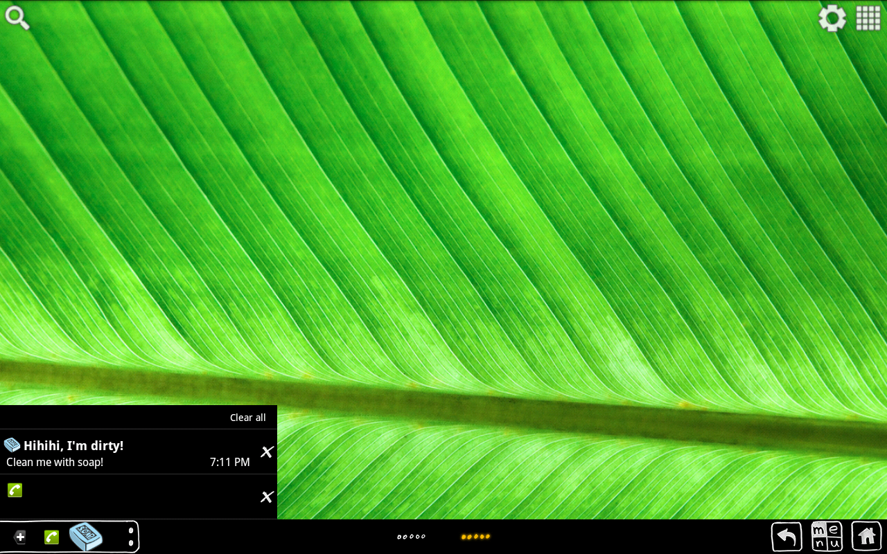

---

## Android 3.0 build HRG34
Reconstructed on 25 August 2026.

Notable features:
- Some XOOM features
- Notification icons in system bar
- Some all apps stuff
- Some customization tray stuff

See here - https://betawiki.net/wiki/Android_3.0_build_HRG34  
Available here - https://github.com/froyocomb/android/tree/froyocomb

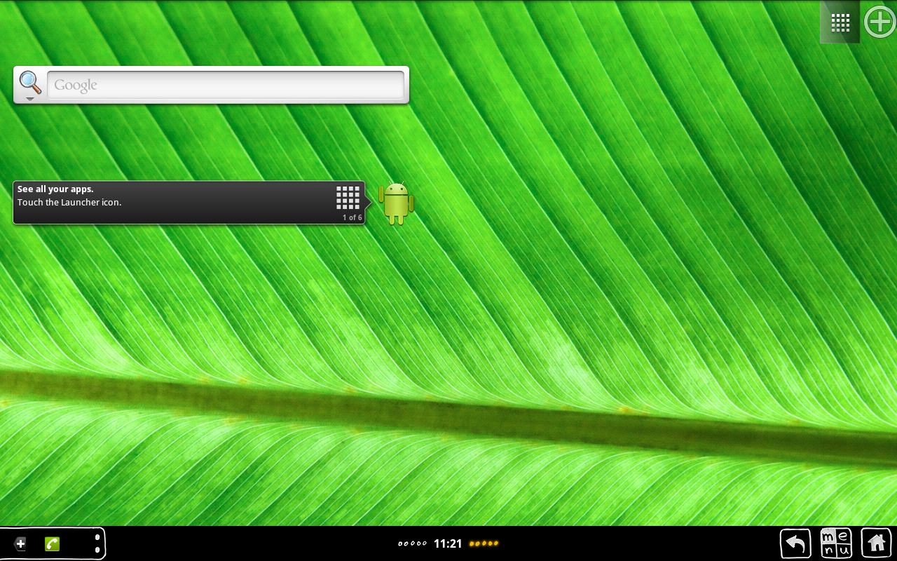

---

## Android 3.0 build HRG28
Reconstructed on 22 August 2026.

Notable features:
- The operating system version is now called Froyo. I guess you can call it a "Froyo"comb
- New whiteboard styled design
- Notification tray and clock tray panels new stuff
- Dummy battery and Wi-Fi status indicators
- All apps is now transparent and is separated into 4 tabs
- Customization tray changes
- Browser now has tabs

See here - https://betawiki.net/wiki/Android_3.0_build_HRG28  
Available here - https://github.com/froyocomb/android/tree/froyocomb

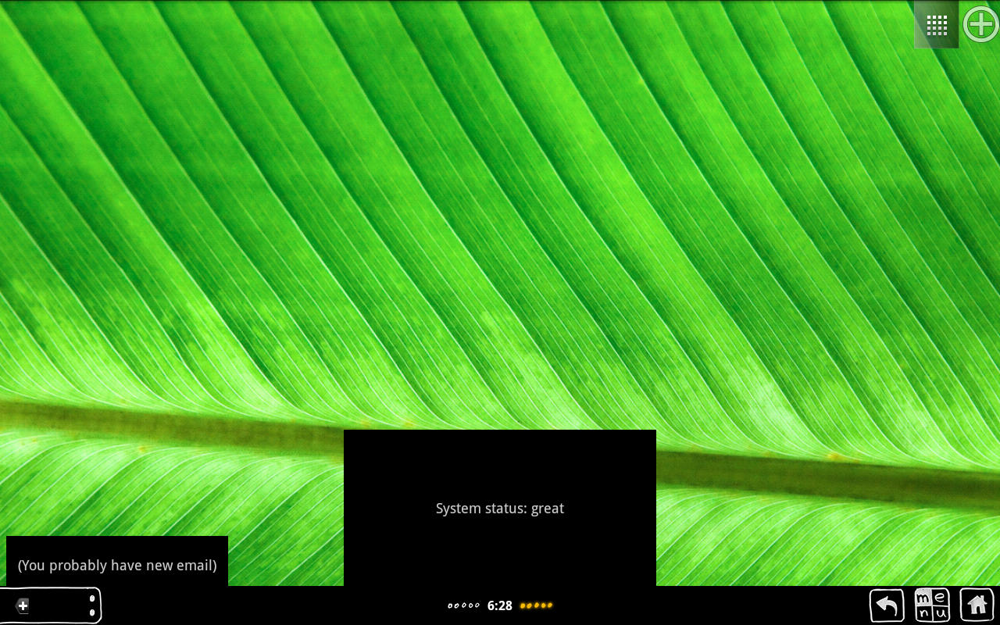

---

## Android 3.0 build HRG23
Reconstructed on 21 August 2026.

Notable features:
- New system bar icon pressed states
- Email two-pane
- LatinIme and LatinIme2Google merged together
- froyo-ub-qsb >> master, so some QSB changes
- Calendar now has a refresh button

See here - https://betawiki.net/wiki/Android_3.0_build_HRG23  
Available here - https://github.com/froyocomb/android/tree/froyocomb

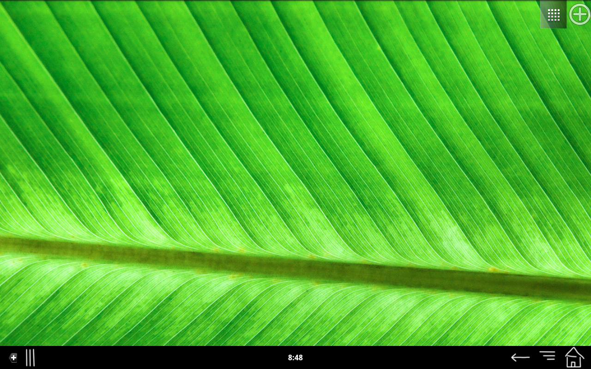

---

## Android 3.0 build HRG19
Reconstructed on 18 August 2026.

Notable features:
- Idk some notification tray
- Some fucked up widget stuff in the "Flow UI"??? where did this name even come from bruh
- MENU has been deprecated in Contacts

See here - https://betawiki.net/wiki/Android_3.0_build_HRG19  
Available here - https://github.com/froyocomb/android/tree/froyocomb

---

## Android 3.0 build HRG14
Reconstructed on 14 August 2026.

Notable features:
- Wow there's a new leaf wallpaper i wonder who doesnt like leaf wallpapers here
- New tabs drawers whatever the hell in Launcher
- Idk some more launcher stuff
- Contacts stuff
- Check the page
- Check the bathroom Joel

See here - https://betawiki.net/wiki/Android_3.0_build_HRG14  
Available here - https://github.com/froyocomb/android/tree/froyocomb

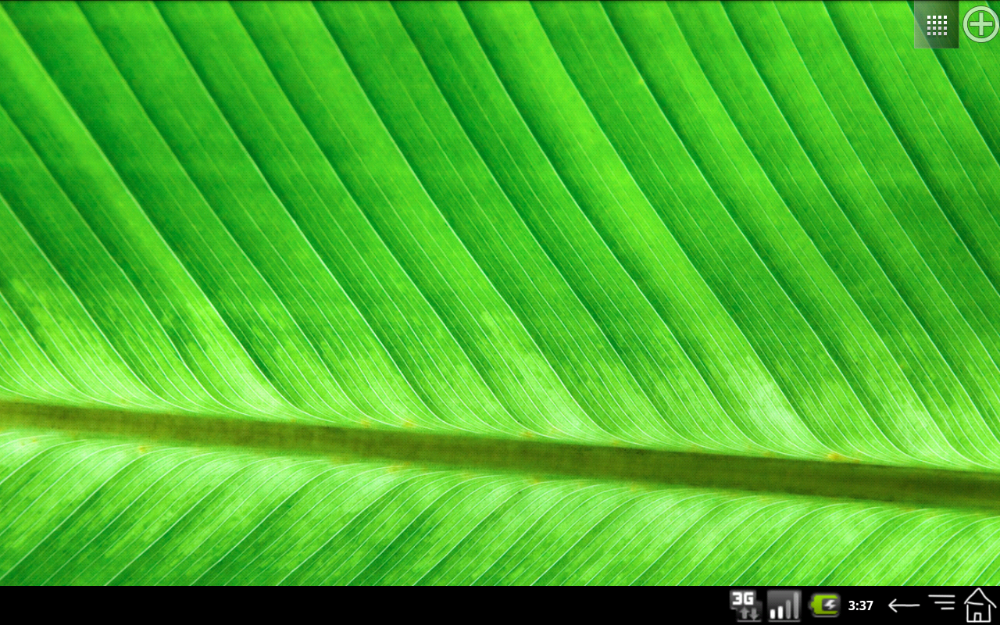 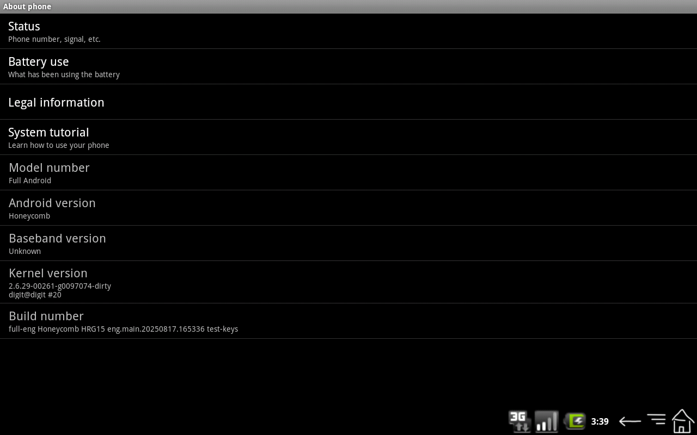

---

## Android 3.0 build HRG08
Reconstructed on 3 August 2026.

Notable features:
- full-eng instead of generic-eng
- eMMC support for OTAs
- New status bar
- Contacts Goop removed replaced with Contacts two-pane
- New Calendar AllInOne

See here - https://betawiki.net/wiki/Android_3.0_build_HRG08  
Available here - https://github.com/froyocomb/android/tree/froyocomb

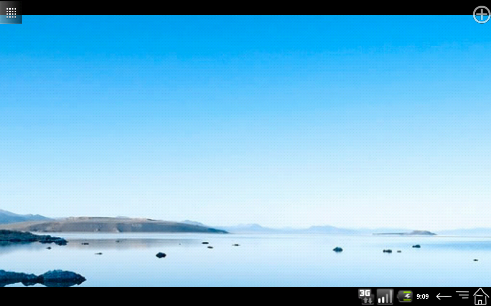

---

## Android 3.0 build HRF90

It's just HRF91.  
https://betawiki.net/wiki/Android_3.0_build_HRF90

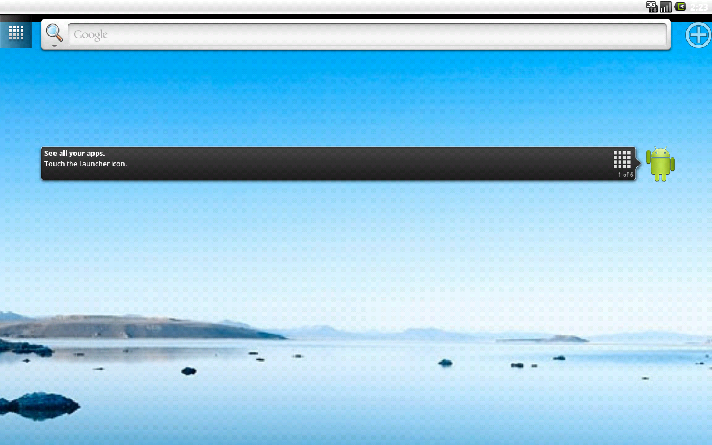

---

## Android 3.0 build HRF86

Reconstructed for likely the final time on 22 July 2026.

Thank you guys again so much for all of the builds and everything we have reconstructed ever since Froyocomb started on August 8th 2025.

I might come back to this project in the future but for now, this marks the end of my doing. Froyocomb wasn't even my idea, it was taylorthedeveloper's, i just actually put the idea into motion and turned into it into what it is now.

Thanks y'all again again. 08-08-2025 to 07-22-2026.

See here - https://betawiki.net/wiki/Android_3.0_build_HRF86  
Available here - https://github.com/froyocomb/android/tree/froyocomb

---

## Android 3.0 build HRF78
Reconstructed on 12 July 2026.

Notable features:
- xLarge bar in Browser

See here - https://betawiki.net/wiki/Android_3.0_build_HRF78

Available here - https://github.com/froyocomb/android/tree/froyocomb

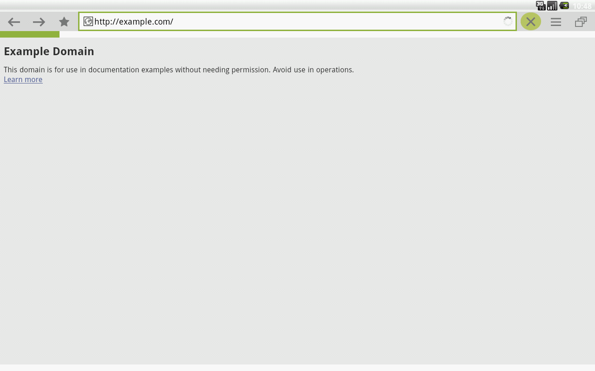

---

## Android 3.0 build HRF72
Re-done on 11 July 2026.

Notable features:
- Hooooooooooooooooooooooooooooooooooooooooooooooooooooooooooooooooooooooooooooooooooooooooooooooooooooooooooooooooooooooooooooooooneycomb
- Some Contacts Goop updates
- GalleryNew3D is actually usable

See here - https://betawiki.net/wiki/Android_3.0_build_HRF72

Available here - https://github.com/froyocomb/android/tree/froyocomb

 

---

## Android 3.0 4 June 2010 build (HRF65)
Reconstructed on 9 July 2026.

Notable features:
- STINGRAY SUPPORT YAEHHHHHH 🦈 🦈 🦈 🦈 🦈 🦈 🦈 🔥 🗣️ 🗣️ 🗣️ 🗣️ 🔥🔥🔥🔥🔥🔥🔥🔥
- SystemUI introduced 🔥
- LatinIme2Google now has Ginger Bread (now named Default) as the default theme
- Some GalleryNew3D updates

See here - https://betawiki.net/wiki/Android_3.0_4_June_2010_build

Available here - https://github.com/froyocomb/android/tree/froyocomb

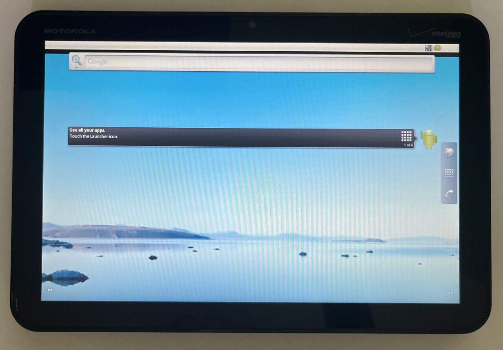 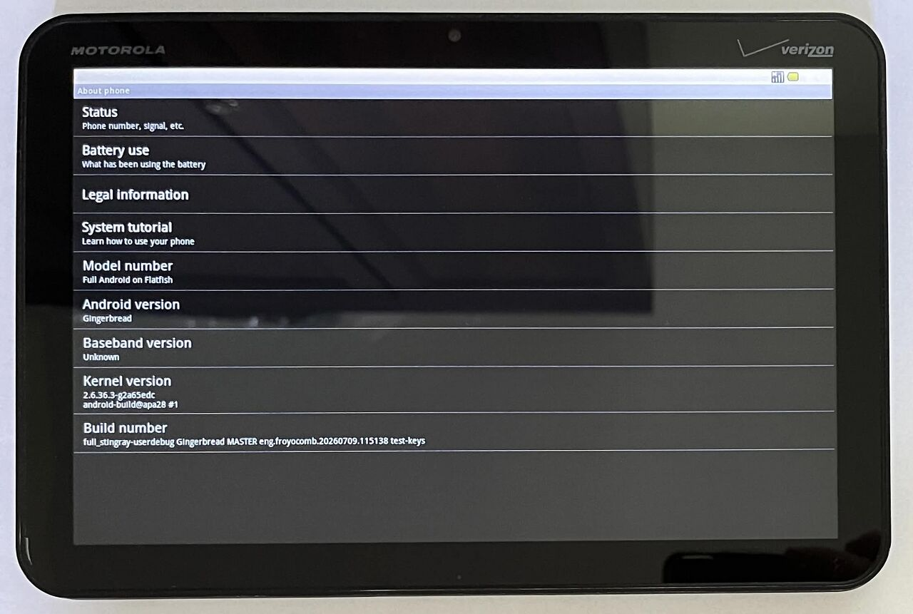

---

## Android 3.0 26 May 2010 build (HRF56)
Reconsturcted on 4 July 2026. HAPPY 4TH OF JULY WHAT THE FUCK IS A KILOMETER 🦅 🇺🇸 🦅 🇺🇸 🦅 🇺🇸 🦅 🇺🇸 🦅 🇺🇸 🦅 🇺🇸 🦅 🇺🇸

Notable features:
- Contacts Goop now has a search function
- GalleryNew3D updated
- Some other stuff

See here - https://betawiki.net/wiki/Android_3.0_26_May_2010_build

Available here -  https://github.com/froyocomb/android/tree/froyocomb

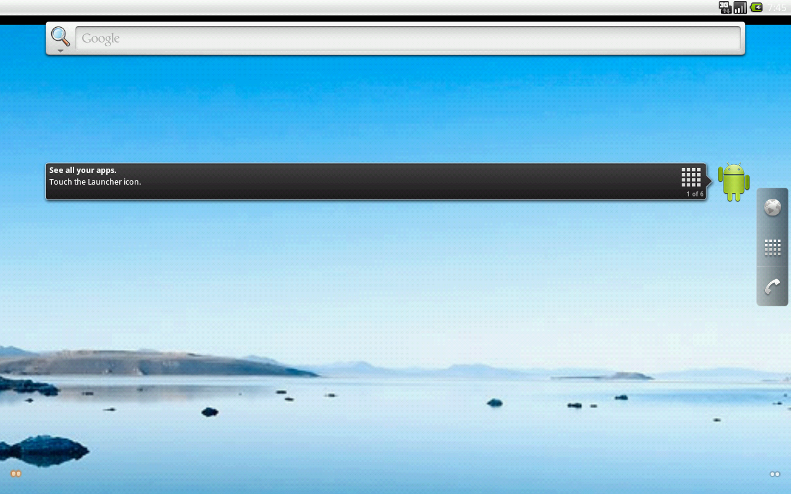 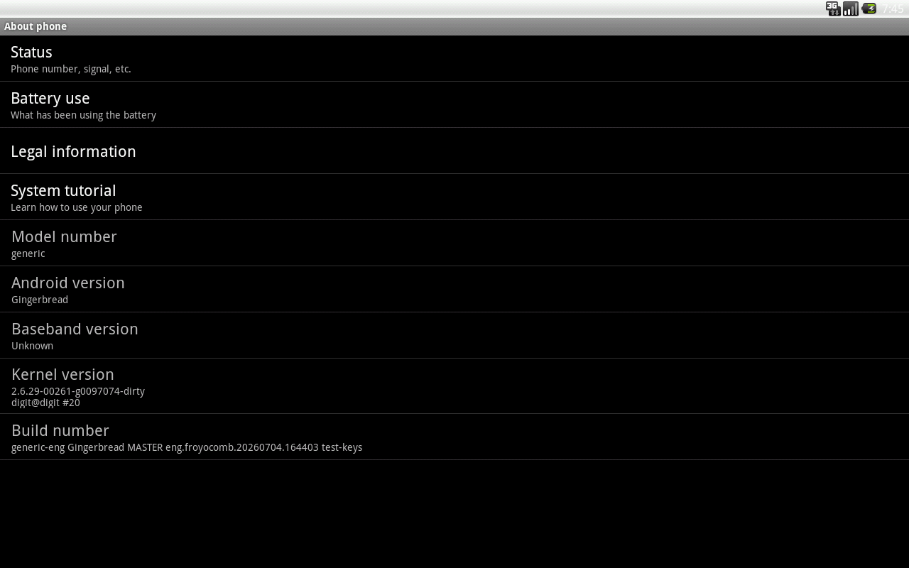

---

## Android 3.0 14 May 2010 build (HRF44)
Reconstructed on 21 June 2026.

Features:
- Contacts Goop
- GalleryNew3D
- XLarge
- Libcore moved
- NativeActivity introduced

See here - https://betawiki.net/wiki/Android_3.0_14_May_2010_build

Available here -  https://github.com/froyocomb/android/tree/froyocomb

 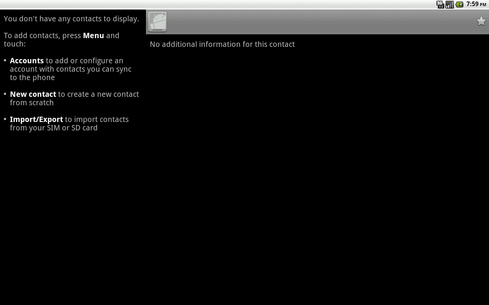

---

## Android 3.0 28 April 2010 build (HRF28)
Reconstructed on 20 June 2026.

See here - https://betawiki.net/wiki/Android_3.0_28_April_2010_build

Available here -  https://github.com/froyocomb/android/tree/froyocomb

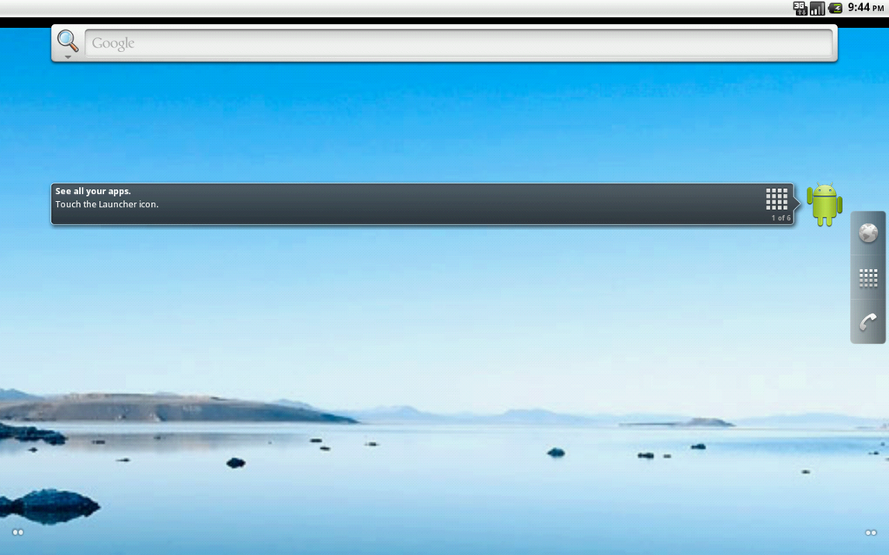 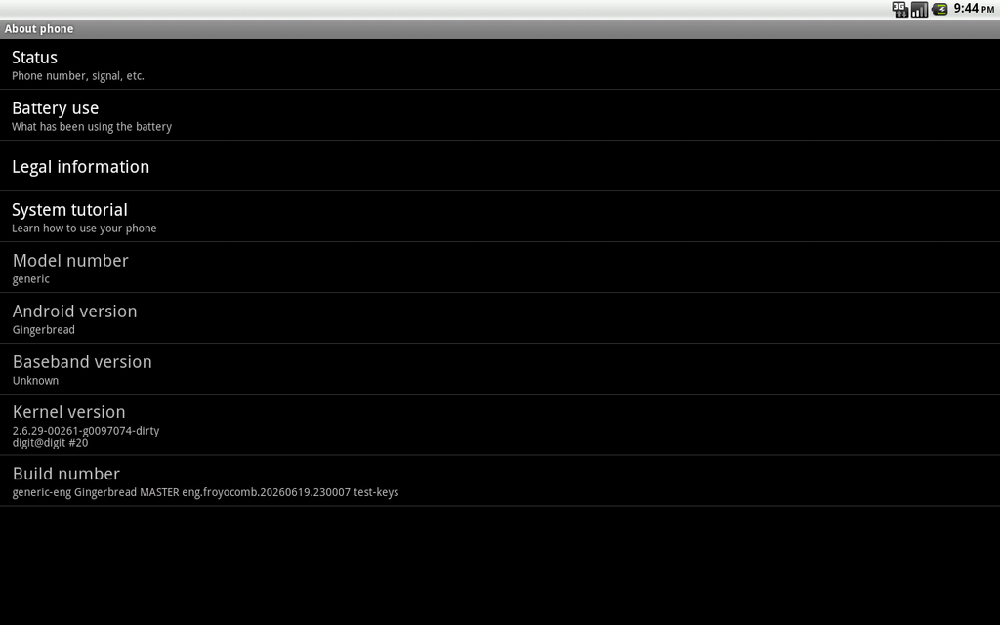

---

## Android 1.5 build 124589 - quick redo

Available here: https://github.com/froyocomb/android/tree/cupcake-den

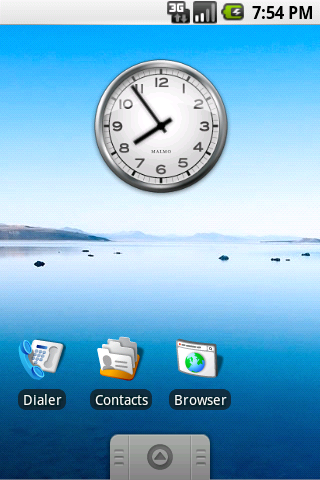

---

## `android-1.5`, `android-1.5r2`, `android-1.5r3` and `android-1.5r4` - tag reconstructions

Re?-Done? on 15 June 2026.

Available here - https://github.com/froyocomb/android/tree/cupcake-den  
Get blobs here - https://github.com/froyocomb/proprietary_vendor/tree/cupcake

---

## Android 1.5 build CRB17 (`android-1.5.xml`)
Re?-Done? on 14 June 2026.

Available here - https://github.com/froyocomb/android/tree/cupcake-den  
Get blobs here - https://github.com/froyocomb/proprietary_vendor/tree/cupcake

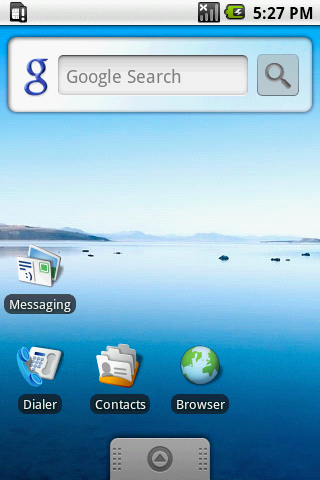

---

## Android 1.0 build TC3 - `TC3-20081021.xml` and `android-1.0.xml`

Re-done on 14 June 2026.

Available here - https://github.com/froyocomb/android/tree/i-cant-believe-its-not-android  
Get blobs here - https://github.com/froyocomb/proprietary_vendor/tree/android-1.0

 

---

## Android Kraken 36 April 2010 build (GRF36)
Reconstructed on 11 June 2026.

Notable features:
- Xlarge screen size
- Moved libcore
- NativeActivity introduced

See here - https://betawiki.net/wiki/Android_2.3_6_May_2010_build

Available here - https://github.com/froyocomb/android/tree/krakenbread  
Get blobs here - https://github.com/froyocomb/proprietary_vendor/tree/gingerbread

 

---

## Android Kraken 27 April 2010 build (GRF27)
Reconstructed on 7 June 2026.

Notable features:
- API 9 kinda but not really its there
- Froyo design

See here - https://betawiki.net/wiki/Android_2.3_27_April_2010_build

Available here - https://github.com/froyocomb/android/tree/krakenbread  
Get blobs here - https://github.com/froyocomb/proprietary_vendor/tree/gingerbread

 

---

## `android-3.2_r1` (HTJ85B) - 99% accurate tag reconstruction
Reconstructed on 4 June 2026.

Available here - https://github.com/froyocomb/android/tree/froyocomb  
Get blobs here - https://github.com/froyocomb/proprietary_vendor/tree/honeycomb

Next: HLK......42B?

---

## `android-3.1_r1` (HMJ37) - tag reconstruction
Reconstructed on 4 June 2026.

Available here - https://github.com/froyocomb/android/tree/froyocomb  
Get blobs here - https://github.com/froyocomb/proprietary_vendor/tree/honeycomb

Next: HTJ85B

---

## `android-3.0_r1.3` (HRI83) - tag reconstruction
Reconstructed on 27 May 2026.

Available here - https://github.com/froyocomb/android/tree/froyocomb  
Get blobs here - https://github.com/froyocomb/proprietary_vendor/tree/honeycomb

Next: HMJ37

---

## `android-3.0_r1.1` (HRI66) - tag reconstruction
Reconstructed on 26 May 2026.

Available here - https://github.com/froyocomb/android/tree/froyocomb  
Get blobs here - https://github.com/froyocomb/proprietary_vendor/tree/honeycomb

Next: HRI83

---

## `android-3.0_r1` (HRI39) - 95% accurate tag reconstruction

Reconstructed on 24 May 2026.

Available here - https://github.com/froyocomb/android/tree/froyocomb  
Get blobs here - https://github.com/froyocomb/proprietary_vendor/tree/honeycomb

Next: HRI66 and HRI83

---

## Android 4.0 9 March 2011 build (IRI68)
Reconstructed on 18 May 2026.

Notable features:
- Yo look m8 i got honeycomb on my phone (its awful)
- Honeycomb Sandwich
- Phone UI runs like you ran the build on a T-Mobile G1

See here - https://betawiki.net/wiki/Android_4.0_9_March_2011_build

Available here - https://github.com/froyocomb/android/tree/i-scream-sandwich  
Get blobs here - https://github.com/froyocomb/proprietary_vendor/tree/ics

 

---

## Android 1.0 build htc-20645.0.8.0.0
even though we can't do much yet

Download here - https://archive.org/details/emulator-20645.7z

See here - https://betawiki.net/wiki/Android_1.0_build_htc-20645.0.8.0.0

---

## Android 5.0 build AAT35
Available here: https://github.com/froyocomb/android/tree/thou-shalt-take-the-L  
See here: https://betawiki.net/wiki/Android_5.0_build_AAT35

Notable features:
- x86_64 is now a compile option (and tbh has been since AAT02, but let's just say AAT35 is the earliest build of L lol)
- Camera2 has some changes but none that are visible
- **A shitton of compile fixes**

 

---

## Android 5.0 build LRX16F
**Final build: LRX21**

Available here: https://github.com/froyocomb/android/tree/thou-shalt-take-the-L  
See here: https://betawiki.net/wiki/Android_5.0_build_LRX16F

Notable features:
- **Nothing**

 

---

## Android 5.0 build LRX05
**Next builds: LRX09G, LRX16F, LRX21**

Available here: https://github.com/froyocomb/android/tree/thou-shalt-take-the-L  
See here: https://betawiki.net/wiki/Android_5.0_build_LRX05

Notable features:
- **Nothing**

 

---

## Android 5.0 build LRW92C
**Next build: LRX05**

Available here: https://github.com/froyocomb/android/tree/thou-shalt-take-the-L  
See here: https://betawiki.net/wiki/Android_5.0_build_LRW92C

Notable features:
- It is now 5.0
- Dialpad ripple effect is now smoother

 

---

## Android L build LRW84B
**Next build: LRW9x, maybe LRX01, maybe not**

Available here: https://github.com/froyocomb/android/tree/thou-shalt-take-the-L  
See here: https://betawiki.net/wiki/Android_5.0_build_LRW84B

Notable features:
- Owner icon is now light blue
- Flashlight in QS in Nexus 6
- TvSettings (weow)

 

---

## Android L build LRW78C
**Next build: LRW84B.... but i'm busy with Android 1.0 at the moment and don't have a usable setup (yet)....**

Available here: https://github.com/froyocomb/android/tree/thou-shalt-take-the-L  
See here: https://betawiki.net/wiki/Android_5.0_build_LRW78C

Notable features:
- NO MORE HDMI MHL CRAP!!!
- Nexus 9 now can use the boot.img generated during compile
- Default owner icon is now pink
- Downloads icon is now Material
- TvQuickSettings!

 

---

## Android L build LRW71C
**Next build: LRW78?**

Available here: https://github.com/froyocomb/android/tree/thou-shalt-take-the-L  
See here: https://betawiki.net/wiki/Android_5.0_build_LRW71C

Notable features:
- Nexus 9 woo baby (some person out there says "the wallpaper is goyim")
- We got that GOOGEL text back on QSB
- RIP SIM cards applet

 

---

## Android L build LRW65D
**Next build: Idk**

Available here: https://github.com/froyocomb/android/tree/thou-shalt-take-the-L  
See here: https://betawiki.net/wiki/Android_5.0_build_LRW65D

Notable features:
- Nexus Player wooo baby
- Updated Cling UI
- New All Apps icon
- Polished all apps transition
- WebView Library is now named Android System Webview
- GoogleKeymaster library introduced

 

---

## Android L build LRW58O
**Next build: WOOOOO YEAH BABY THATS WHAT IV'E BEEN WAITING FOR THATS WHAT ITS ALL ABOUT WOOO WE'RE MAKING A SEPTEMBER BUILD NXET TIME (LRW63)**

Available here: https://github.com/froyocomb/android/tree/thou-shalt-take-the-L  
See here: https://betawiki.net/wiki/Android_5.0_build_LRW58O

---

## Android 1.0 15 January 2008 build
Wait what this is not a reeconstruction main what are you doing

  

---

## Android L build LRW52G
**Next build: LRW58O again**

Available here: https://github.com/froyocomb/android/tree/thou-shalt-take-the-L  
See here: https://betawiki.net/wiki/Android_5.0_build_LRW52G

Notable features:
- Ambient Display has been introduced
- Funny calibri regulator information for Nexus 6
- New nav bar buttons
- New icons for Calculator, Clock, Contacts and Email
- New General settings in Dialer
- Final design of Email app

Additionally it is the last with:
- Water, Black Hole, Grass and Nexus Live Wallpapers
- API 20

 

---

## Android L build LRW45K - quick redo

Available here: https://github.com/froyocomb/android/tree/thou-shalt-take-the-L  
See here: https://betawiki.net/wiki/Android_5.0_build_LRW45K

 

---

## Android L build LRW40
**Next build: LRW45K fast re-do then some LRW5x build**

Available here: https://github.com/froyocomb/android/tree/thou-shalt-take-the-L  
See here: https://betawiki.net/wiki/Android_5.0_build_LRW40

Notable features:
- Rip dalvik
- No more yellow in dialer and contacts
- New locking animation
- Light-blue icons and dialogs are now the RTM teal color

 

---

## Android L build LRW29H
**Next build: LRW34, 35?**

Available here: https://github.com/froyocomb/android/tree/thou-shalt-take-the-L  
See here: https://betawiki.net/wiki/Android_5.0_build_LRW29H

Notable features:
- Dark blue Phone app
- New SIM cards applet in Settings

 

---

## Android L build LRW22B
**Next build: LRW27/LRW28?**

Available here: https://github.com/froyocomb/android/tree/thou-shalt-take-the-L  
See here: https://betawiki.net/wiki/Android_5.0_build_LRW22B

Notable features:
- AOSP has branched off to lmp-dev and lmp-release
- Nexus Player support is now in the works although it just crashes when you try to load this build
- Nexus 6 now takes advantage of its xxxhdpi resolution instead of using the Nexus 5 xxhdpi resolution, funilly enough making a lot of the UI elements incredibly big on the phone
- Launcher3 now has a transition for All Apps
- The assets for Launcher3 have been updated, in specific the All Apps button and page indicators
- The Clock is now once again white instead of the color of the background behind it
- The top header of the Phone app is now dark blue instead of light blue which makes it look really odd
- MediaProvider is now Material Design-themed instead of Holo-themed.

 

---

## Android L build LDW13B
**Next build: LRW21?**

Available here: https://github.com/froyocomb/android/tree/thou-shalt-take-the-L  
See here - https://betawiki.net/wiki/Android_5.0_build_LDW13B

Notable features:
- For some reason the clock now matches the background
- Keyboard is now white instead of blue
- Wider quick settings and can now be swiped down with two fingers
- All Apps background is no longer transparent
- Notifications is now named "Sound & Notification" in Settings and the white background used in applets is now again brighter
And more!

 

---

## Android L 7 July 2014 build/AAW07/LRW07
## Don't put it to sleep!
**Next build: LDW13B**

Available here: https://github.com/froyocomb/android/tree/thou-shalt-take-the-L  
See here - https://betawiki.net/wiki/Android_5.0_7_July_2014_build

Notable features:
- New method of sideloading packages
- It crashes when you put the device running it to sleep (that's a feature right?)

 

---

## Android L 2 July 2014 build/AAW02/LRW02
**Next build: LRW06/LRW07 (July 6/7th)**

Available here: https://github.com/froyocomb/android/tree/thou-shalt-take-the-L  
See here - https://betawiki.net/wiki/Android_5.0_2_July_2014_build

Notable features:
- Nexus 6 now has software thermal throttling
- Darker settings background

 

---

## Android L 28 June 2014 build/AAV88/LRV88
**No more V, time for W's**  
**Next build: LRW02 (July 2nd)**

Available here: https://github.com/froyocomb/android/tree/thou-shalt-take-the-L  
See here - https://betawiki.net/wiki/Android_5.0_28_June_2014_build

Notable features:
- Nexus 6 now has its camera tree merged in but not used yet
- Camera app is now `ub-camera-glacier` instead of the deprecated-ish master one
- New    L O C K         N O W         option in Power menu
- Accounts applet in Settings now has an icon

 

---

## Android L 21 June 2014 build/AAV81/LRV81
**LPV81C but cooler, again**

Available here:  
https://github.com/froyocomb/android/tree/thou-shalt-take-the-L  
See here - https://betawiki.net/wiki/Android_5.0_21_June_2014_build

Notable features:
- Fingerprint support in Nexus 6
- Updated Emergency Dialer
- Removed "X" close in recents
- Taller search box
- Nexus 5 tree now uses its own camera tree

 

---

## Android L 19 June 2014 build/AAV79/LRV79

**As in LPV79 but good......... right?**

Available here:  
https://github.com/froyocomb/android/tree/thou-shalt-take-the-L  
See here - https://betawiki.net/wiki/Android_5.0_19_June_2014_build

Notable features:
- We got that Nexus 6
- I didn't see any other than that, nothing interesting in AOSP either

 

---

## Android L 13 June 2014 build/AAV73/LRV73
Reconstructed on 16 March 2026  
Available here: https://github.com/froyocomb/android/tree/thou-shalt-take-the-L

Notable features:
- Nexus 6 now boots to the lock screen/home screen!
- Boot screen is now animated
- Updated nav bar icons
- Contacts app material design redesign
- Keyboard is now Material Design-themed again after being fucked up in LRV72

  

---

## Android 3.0 19 April 2010 build (HRF19)

Reconstructed on 15 March 2026

**Mmmmmm... Gingerbread?!**

See here - https://betawiki.net/wiki/Android_3.0_19_April_2010_build  
**Download here - https://pixeldrain.com/u/AKLJpXKs**  
Available here for compile - https://github.com/froyocomb/android/tree/froyocomb

Run this build on the emulator included on my "Android 3.0 Emulator" archive.org page

Enjoy!

 

---

## Android 4.1 build IRL74
Reconstructed on 13 March 2026

**Notable features**:
- API 15 is now final
- Menu icon tablet UI thing (read the article)
- UI has been made more responsive
- State changes have been optimized
- Launcher2 All Apps -> Workspace transition is now smoother

See here - https://betawiki.net/wiki/Android_4.1_build_IRL74

Available here - https://github.com/froyocomb/android/tree/jolly-bean-jolly-bean  
Get blobs here (i've fixed the apps and now they properly copy over) - https://github.com/froyocomb/proprietary_vendor/tree/jellybean

 

---

## Android 4.1 build IRL68
Reconstructed on 12 March 2026  
Available here: https://github.com/froyocomb/android/tree/jolly-bean-jolly-bean

See here -https://betawiki.net/wiki/Android_4.1_build_IRL68

Available here - https://github.com/froyocomb/android/tree/jolly-bean-jolly-bean  
Get blobs here - https://github.com/froyocomb/proprietary_vendor/tree/jellybean

 

---

## Android L 12 June 2014 build/AAV72/LRV72
Reconstructed on 10 March 2026  
Available here: https://github.com/froyocomb/android/tree/thou-shalt-take-the-L

Notable features:
- API 19 -> 20
- Removed Google dots on Notification bar seperator
- And.... see for yourself in the photo below!

See here too - https://betawiki.net/wiki/Android_5.0_12_June_2014_build

---

## Android L 11 June 2014 build/AAV71/LRV71
Reconstructed on 8 March 2026  
Available here: https://github.com/froyocomb/android/tree/thou-shalt-take-the-L

Notable features:
- Retail Launcher3 icons
- Bolded fonts
- This sucked to reconstruct

See here - https://betawiki.net/wiki/Android_5.0_11_June_2014_build

 

---

## Android L 10 June 2014 build/AAV70/LRV70
Reconstructed on 7 March 2026  
Available here: https://github.com/froyocomb/android/tree/thou-shalt-take-the-L

Notable features:
- New boot animatiooooooooooon!

See here - https://betawiki.net/wiki/Android_5.0_10_June_2014_build

 

---

## Android L 9 June 2014 build/AAV69/LRV69
Reconstructed on 4 March 2026  
Available here: https://github.com/froyocomb/android/tree/thou-shalt-take-the-L

Notable features:
- Quantum Paper renamed to Material Design
- Updated ADB (USB debugging) logo
- Spinny wheel updated
- Ripple effect updated but includes artifacts alongside it
- Navigation bar is now always black unless the app enforces it to be transparent
- Settings app is even more like RTM now

See here - https://betawiki.net/wiki/Android_5.0_9_June_2014_build

 

---

## Android 3.0 build HRF72 - 2026 Edition
Reconstructed on 1 March 2026.

Notable features:
- Now with Xoom support!

See here - https://betawiki.net/wiki/Android_3.0_build_HRF72

Available here - https://github.com/froyocomb/android/tree/froyocomb

 

---

## Android 4.0 14 April 2011 build/IRJ14
Reconstructed on 27 February 2026.

Notable features:

See here - https://betawiki.net/wiki/Android_4.0_14_April_2011_build

Available here - https://github.com/froyocomb/android/tree/i-scream-sandwich  
Get blobs here - https://github.com/froyocomb/proprietary_vendor/tree/ics

 

---

## Android 4.0 6 April 2011 build/IRJ06
Reconstructed on 26 February 2026.

Notable features:
- You can do even more things in the phone UI now
- I dunno

See here - https://betawiki.net/wiki/Android_4.0_6_April_2011_build

Available here - https://github.com/froyocomb/android/tree/i-scream-sandwich  
Get blobs here - https://github.com/froyocomb/proprietary_vendor/tree/ics

 

---

## Android 2.3 build GRH35
Reconstructed on 25 February 2026.

Notable features:
- It aint corrupted anymore

See here - https://betawiki.net/wiki/Android_2.3_build_GRH35

 

---

## Android 4.0 24 March 2011 build/IRI83
Reconstructed on 24 February 2026.

Notable features:
- You can do more things in the phone UI now
- It runs slow
- I dunno diff it and see lmao

See here - https://betawiki.net/wiki/Android_4.0_24_March_2011_build

Available here - https://github.com/froyocomb/android/tree/i-scream-sandwich  
Get blobs here - https://github.com/froyocomb/proprietary_vendor/tree/ics

 

---

## Android 4.0 build IRJ66+1
Reconstructed on 23 February 2026

Notable features:
- Kind of Galaxy Nexus support (see page, the build RUNS)
- Removed wallpapers tab in All apps and updated Market icon
- Might be more i didnt diff it

See here - https://betawiki.net/wiki/Android_4.0_build_IRJ67

Available here - https://github.com/froyocomb/android/tree/i-scream-sandwich  
Get blobs here - https://github.com/froyocomb/proprietary_vendor/tree/ics

 

---

## Android 4.0 build IRJ60 - 2026 Reimagined
Made more accurate on 23 Februrary 2026

- Now more accurate
- With Nexus S and Xoom support

See here - https://betawiki.net/wiki/Android_4.0_build_IRJ60

Available here - https://github.com/froyocomb/android/tree/i-scream-sandwich  
Get blobs here - https://github.com/froyocomb/proprietary_vendor/tree/ics

 

---

## Android L 3 June 2014 build/AAV63/LRV63
Reconstructed on 21 February 2026  
Available here: https://github.com/froyocomb/android/tree/thou-shalt-take-the-L

Notable features:
- I have nothing to say, check out the page

See here - https://betawiki.net/wiki/Android_5.0_3_June_2014_build

 

---

## Android L 28 May 2014 build/AAV58/LRV58
Reconstructed on 20 February 2026  
Will be available here soon: https://github.com/froyocomb/android/tree/thou-shalt-take-the-L

Notable features:
- Fully transparent system bars
- Overhauled Settings app

See more here - https://betawiki.net/wiki/Android_5.0_28_May_2014_build

 

---

## Android 5.0 build LRW58O
Reconstructed on 19 February 2026  
Available here: https://github.com/froyocomb/android/tree/thou-shalt-take-the-L

Notable features:
- Contains the finalized Navigation Bar

See more here - https://betawiki.net/wiki/Android_5.0_build_LRW58O

 

---

## Android L build AAV52B
Reconstructed on 19 February 2026  
Available here: https://github.com/froyocomb/android/tree/thou-shalt-take-the-L

Final "AA" master branch build

Notable features:
- Adaptable system bars
- Split notifications
- Updated lock screen
- Updated keyboard
- Dark themed volume bars
- Updated Settings app with cyan Quantum Paper icons

See more here - https://betawiki.net/wiki/Android_5.0_build_AAV52B

 

---

## Android L build AAV45F
Reconstructed on 18 February 2026  
Available here: https://github.com/froyocomb/android/tree/thou-shalt-take-the-L

Notable features:
- Redesigned Quick Settings and notification bar
- Redesigned keyboard
- The Settings app now has Quantum Paper icons
- L logo is now properly cropped
- Slight modifications to the Phone app
- Apps in the recents tab now have an "X" next to them

See more here - https://betawiki.net/wiki/Android_5.0_build_AAV45F

 

---

## Android L build AAV38C
Reconstructed on 17 February 2026  
Available here: https://github.com/froyocomb/android/tree/thou-shalt-take-the-L

Notable features:
- Webdriver Torso easter egg
- New animations
- Updated lock screen

See more here - https://betawiki.net/wiki/Android_5.0_build_AAV38C

