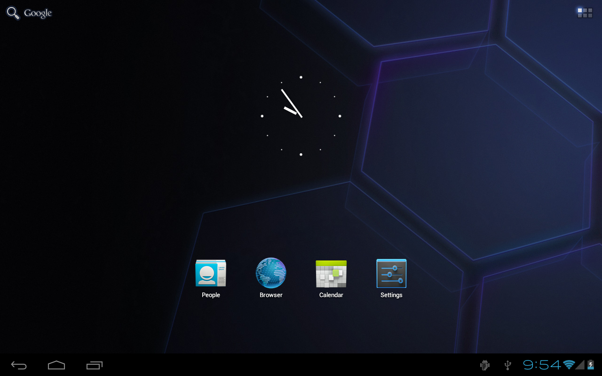
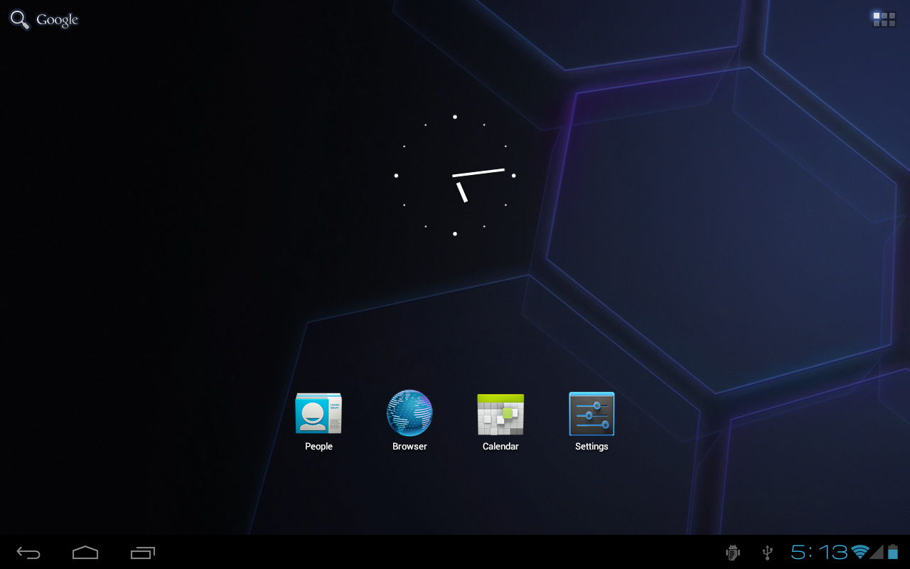
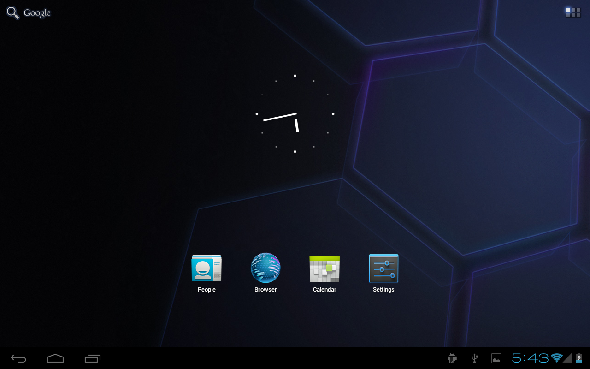

# RECENT BUILDS

## Android 4.1 build IRL40
Reconstructed on 22 October 2026.

Notable features:
- Minor layout changes on Tablet UI Notification panel header
- Switches are now flipped
- Toggle buttons are now blue
- Minor layout changes on Launcher Apps drawer header

The manifest is available for compile here -  https://github.com/froyocomb/android/tree/jolly-bean-jolly-bean/4.1/IRL40.xml

---

## Android 4.1 build IRL34
Reconstructed on 21 October 2026.

This build version is now 4.1, originally as an Android Ice Cream Sandwich MR1 change and being automerged for this branch.

Notable features:
- Initial use of API 15
- Android Recovery now uses C++ files.
- Re-introduction of Android Dreams
- Lock screen "waveview widget" slider on Tablet UI now is now unified with the Phone UI counterpart
- Updated Tablet UI Notification panel header layout and assets
- Fixes for Quick Settings layout
- Bluetooth is now re-enabled on Tablet UI Status Bar/Notification panel header
- Fixed Tablet UI Recent Apps pane button
- Checkbox and radio button assets are now sharper and blue
- Fixes for Tablet UI Widgets drawer layout

The manifest is available for compile here -  https://github.com/froyocomb/android/tree/jolly-bean-jolly-bean/4.1/IRL34.xml

---

## Android 4.1 build IRL27
Reconstructed on 20 October 2026.

This is the first build tagged after the first Android Ice Cream Sandwich Factory ROM 2 build and is considered the first build of Android Jelly Bean.

The manifest is available for compile here -  https://github.com/froyocomb/android/tree/jolly-bean-jolly-bean/4.1/IRL27.xml

[See more →](../CHANGELOG.md)
